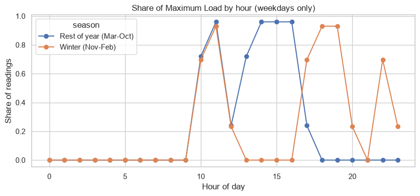
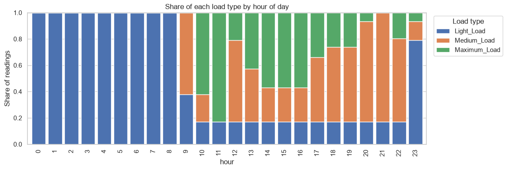
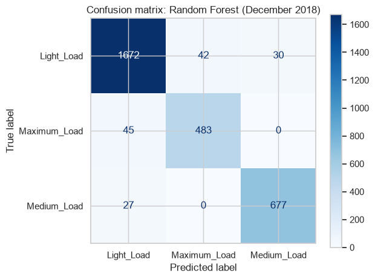
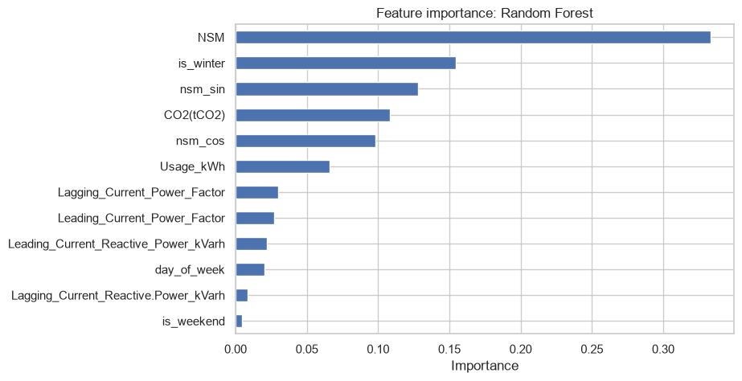

# Power System Load Type Prediction

A machine learning model that predicts the **load type** (Light, Medium or Maximum) of a steel plant's power system from 15-minute electrical readings, validated honestly on the **last month of data**, which the model never saw during training or model selection.

## TL;DR

| | |
|---|---|
| **Task** | 3-class classification on time-series data |
| **Test set** | December 2018 (last month of data, 2,976 readings) |
| **Final model** | Random Forest, selected by time-series cross-validation, then tuned |
| **Test accuracy / macro F1** | **0.95 / 0.95** (baseline Logistic Regression: 0.66 / 0.54) |
| **Key finding** | The load type follows a **seasonal time-of-use schedule**. The model barely depends on energy usage, and a winter flag is essential. |

---

## Contents
1. [Problem](#problem)
2. [Dataset and data quality](#dataset-and-data-quality)
3. [Approach](#approach)
4. [What the data shows](#what-the-data-shows)
5. [Results](#results)
6. [What drives the predictions?](#what-drives-the-predictions)
7. [Limitations and next steps](#limitations-and-next-steps)
8. [Project structure](#project-structure)
9. [How to run](#how-to-run)

---

## Problem

Predict `Load_Type` (**Light_Load**, **Medium_Load**, **Maximum_Load**) from historical readings: energy usage, reactive power, CO2, power factors and time of day.

- **Validation rule:** the last month of data is the test set, so the model is judged on recent, unseen data, as it would be in real use.
- **Metrics:** accuracy, precision, recall and F1-score. These are macro-averaged because the classes are imbalanced (about 52% Light, 28% Medium, 21% Maximum).

## Dataset and data quality

35,040 readings, one every 15 minutes through 2018. Before modelling, the raw file was checked against what the columns should look like, and several problems were found and fixed:

| Issue found in the raw data | Scale | Fix |
|---|---|---|
| `NSM` (seconds from midnight) contradicts the timestamp | ~3,400 rows, plus 455 missing | Rebuilt from the timestamp |
| Power factor above 100 (physically impossible) | 3,226 lagging, 2,685 leading | Set to missing |
| Missing values in every numeric column | 1% to 4.4% of rows | Imputed with **training-set medians only** |
| Duplicate timestamp | 1 row | Removed |

Imputation lives inside the model pipeline, so no information from the test month leaks into training.

## Approach


1. **Cleaning:** explicit date parsing, duplicate removal, `NSM` rebuilt, invalid values flagged.
2. **Feature engineering:** day of week, weekend flag, **winter flag (Nov to Feb)**, and cyclical sine/cosine encoding of time of day so that 23:45 and 00:00 are neighbours.
3. **Chronological split:** training on January to November (32,064 rows), testing on December (2,976 rows). Rows are never shuffled, so the model cannot peek into the future.
4. **Model selection without touching the test set:** five models were compared with `TimeSeriesSplit` cross-validation on the training data only. The winner was tuned with `RandomizedSearchCV`, and the test month was used a single time at the end.

## What the data shows

**The label follows a schedule that changes with the season.** On weekdays, Maximum Load appears in the late morning in every season. From March to October it returns in the afternoon, but in winter the afternoon drops out and the peak moves to the evening.



**Time of day structures the label.** Everything before 09:00 is Light Load, Maximum Load concentrates around midday, and Medium Load dominates the evening.



This is why a linear model fails and non-linear tree ensembles work: the label depends on windows of hours, and a window cannot be drawn with a straight line.

## Results

Selection used cross-validation on training data. The test columns are reported for information.

| Model | CV macro F1 | Test accuracy | Test macro F1 |
|---|---|---|---|
| Logistic Regression (baseline) | 0.757 | 0.659 | 0.543 |
| Decision Tree | 0.939 | 0.917 | 0.912 |
| XGBoost | 0.956 | 0.950 | 0.943 |
| LightGBM | 0.956 | 0.951 | 0.944 |
| **Random Forest** | **0.956** | **0.955** | **0.949** |

The three ensembles are essentially tied, and Random Forest was selected by a narrow margin. Tuning lifted its CV macro F1 slightly (0.956 to 0.959), and the **tuned final model** scores:

| Class | Precision | Recall | F1 |
|---|---|---|---|
| Light | 0.96 | 0.96 | 0.96 |
| Medium | 0.96 | 0.96 | 0.96 |
| Maximum | 0.92 | 0.91 | 0.92 |
| **Overall (macro)** | **0.95** | **0.95** | **0.95** |



- **Medium and Maximum are never confused with each other** (0 readings in either direction). The errors are almost all Light versus the other two.
- Mistakes concentrate in the **evening (18:00 to 22:00, about 80 to 86% correct)** and on weekends and irregular days such as holidays.

## What drives the predictions?

Feature importance shows what the model *uses*, but not what *causes* the label. To test how robust the model really is, the same model was retrained with feature groups removed:

| Setup | Accuracy | Macro F1 |
|---|---|---|
| All features | 0.955 | 0.949 |
| Without `Usage_kWh` | 0.932 | 0.924 |
| Without `Usage_kWh` and `CO2(tCO2)` | 0.932 | 0.925 |
| Schedule only (time, weekday, season; no electrical readings) | 0.862 | 0.858 |
| Schedule **without** the season flag | 0.653 | 0.540 |



**Takeaways**
- **The model does not depend on usage.** Dropping `Usage_kWh` and its CO2 proxy costs only 2 to 3 points of macro F1, so the high score is not simply "usage predicts load type".
- **The schedule explains most of the label.** With no electrical readings at all, time of day, weekday and season reach about 0.86 macro F1. The electrical readings add the remaining ~9 points, probably by showing whether the plant is actually running.
- **Season is essential.** Removing the winter flag collapses the score from 0.86 to 0.54.
- **Why not the raw month number?** December never appears in training, so a raw month value cannot generalise to it. The *season* does carry over: the model has seen November, January and February.

## Limitations and next steps

**Limitations**
- Only one year of data, and a single test month. December is quieter than average (59% Light Load against 51% in training), so scores for other months may differ.
- Holidays and irregular days are not modelled, and they account for many of the remaining errors.
- The top three ensembles are effectively tied, so the choice of Random Forest is not decisive.

**Next steps**
- Add a public-holiday or plant-shutdown flag.
- Add lag or rolling features (for example, usage over the previous hour).
- Validate with walk-forward monthly folds and additional years of data.
- Wrap the saved model in a small prediction function or API.

## Project structure

```
.
├── data/
│   └── raw/                  # original dataset (never edited)
├── notebooks/
│   └── load_type_prediction.ipynb   # full analysis, start here
├── src/
│   ├── data_prep.py          # loading, cleaning, chronological split
│   ├── features.py           # time and season features
│   └── evaluate.py           # models, cross-validated comparison, tuning grids
├── reports/
│   ├── figures/              # all plots used in this README
│   ├── model_comparison.csv
│   └── feature_ablation.csv
├── models/                   # saved model (generated by the notebook)
├── requirements.txt
└── README.md
```

## How to run

```bash
git clone https://github.com/Sanvi09Kulkarni/load-type-prediction.git
cd load-type-prediction

python -m venv .venv
source .venv/bin/activate        # Windows: .venv\Scripts\activate
pip install -r requirements.txt

jupyter notebook notebooks/load_type_prediction.ipynb
```

Choose **Run All**. The notebook runs top to bottom in under a minute, uses a fixed random seed (`42`), and regenerates every figure, result table and the saved model.

## Author

**Sanvi Kulkarni**
[GitHub](https://github.com/Sanvi09Kulkarni) | [LinkedIn](https://www.linkedin.com/in/sanvi-kulkarni-a75540251)